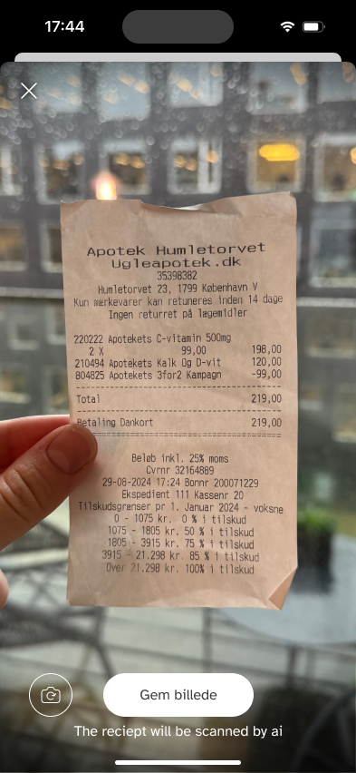
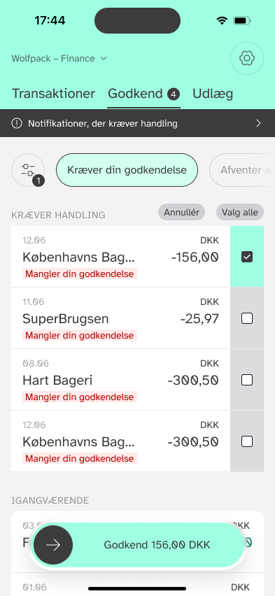
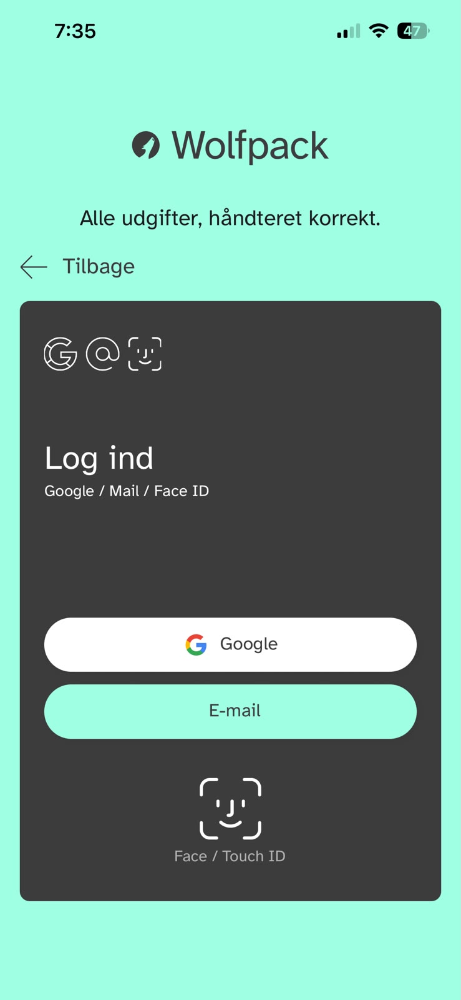
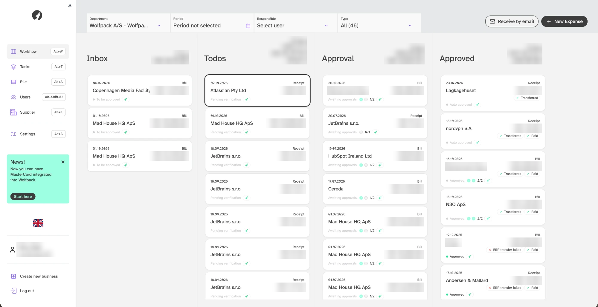

<h1 align="center">Ishaq Ashraf · App Portfolio</h1>
<h3 align="center">Senior Full Stack & React Native Engineer · 8+ years · Fintech, health and AI-powered products</h3>

  
  
  
  

  📍 Karachi, Pakistan · 🌍 Open to remote roles worldwide (any time zone) and relocation with visa sponsorship

  <b>8+ years</b> in software &nbsp;·&nbsp; <b>6+ years</b> remote with US, Swiss and Danish teams &nbsp;·&nbsp; <b>20+</b> production apps shipped (best ones below)

---

## ⭐ Featured work

### 1. Wolfpack · Fintech expense management (2024 to now)
**Role:** Senior React Native Consultant · owns product and engineering on a small startup team (Copenhagen, remote)

  
  
  

  

- **AI receipt scanner:** camera capture (JPEG, PNG, PDF) → automatic expense-data extraction, streamed live into the app and web dashboard
- **Security-first auth:** biometric sign-in with **Ed25519** cryptographic signatures and secure keychain storage
- **Real-time sync:** custom Server-Sent Events engine with auto-reconnect and exponential backoff
- **Payments:** backend endpoints for **Danske Bank** banking API integration
- **AI features:** agents with tool calling, RAG workflows and chatbots (LangChain, Llama, vector databases) with streaming responses
- **Web:** Next.js (App Router) portal for expense approvals, permissions and real-time financial reporting
- **Delivery:** automated TestFlight and Google Play releases via Bitbucket Pipelines and EAS

**Stack:** React Native · Expo · Next.js · TypeScript · Supabase (Postgres) · Drizzle ORM · SSE · LangChain

  
  
  

### 2. Eyelevel ADHD (hiToco®) · Digital mental health (2022)
**Role:** Senior React Native Engineer at Eyelevel.care (Basel, remote)

- Resolved **100+ UI/UX bugs** and optimized rendering, raising user satisfaction and engagement by **20%**
- Integrated Matomo analytics and performance monitoring; rebuilt the Jest testing setup

  
  

### 3. Looptify · Full product lifecycle (2022 to 2024)
**Role:** Senior React Native & Full Stack Engineer (Los Angeles, remote)

- Owned the whole product end to end: **React Native app**, **React/TailwindCSS admin panel** and **Node.js backend**
- Designed the Prisma/MySQL data model for better performance, latency and data integrity
- CI/CD with Fastlane, GitHub Actions and AWS Amplify

  
   🗄️ No longer on the stores. Link opens an archived copy of the App Store page.

---

## 🤖 AI projects

### [Livora AI](https://devpost.com/software/livora-ai) · Vitalitics™ 2026 Hackathon
React Native app that turns blood and ultrasound reports into a personalized **Liver Health Score**, with an AI chat assistant, tracking over time and gamified milestones. I owned onboarding and auth, report upload, the AI chat and the API layer.

### [VoltShield](https://github.com/farheenimam/VoltSheild) · FORTYGUARD Urban Heat Hackathon 2026
React + Node.js/Express web app with a **multi-agent AI pipeline** (heat, shade, financial, manager and critique agents) that predicts EV-charger overheating risk and simulates mitigations.

<!-- The Render demo link timed out (free instances sleep). Re-add it only with a note: "demo may take ~30s to wake up". -->

<!-- TODO (recommended): once you publish the open-source demos, add them here:
### react-native-ed25519-biometric-auth · Biometric sign-in with Ed25519 signatures
### sse-realtime-sync · SSE provider with reconnect and exponential backoff
### ai-receipt-scanner-demo · Camera capture → LLM data extraction
-->

---

## 📱 More shipped apps

| App | Industry | Built at | My role | Status |
|---|---|---|---|---|
| [TapIn Sports](https://apps.apple.com/us/app/tapin-sports/id1635323518) | Sports / community | Makeen Technologies | React Native development | ✅ [App Store](https://apps.apple.com/us/app/tapin-sports/id1635323518) · [Google Play](https://play.google.com/store/apps/details?id=me.vyoo.sports) |
| Apple TV app (Netflux) | Video / entertainment | Makeen Technologies | Designed, built and shipped a production **tvOS** app with React Native tvOS | [Project page](https://makeen.io/netflux-video-sharing/) |
| Transform 2.0 | Business software | Makeen Technologies | Contributed to the core product | 🔒 Internal platform (login required) |
| [Danube](https://apps.apple.com/pk/app/danube-%20%D8%A7%D9%84%D8%AF%D8%A7%D9%86%D9%88%D8%A8/id1097703117) | Retail (UAE supermarket) | Cooperative Computing | React Native development | ✅ [App Store](https://apps.apple.com/pk/app/danube-%20%D8%A7%D9%84%D8%AF%D8%A7%D9%86%D9%88%D8%A8/id1097703117) · [Google Play](https://play.google.com/store/apps/details?id=com.app.danube) |
| GoSpark | Deals / food discovery | Cooperative Computing | Migrated legacy code to modern React Native (**+40% client speed**); iBeacons, push, analytics SDKs | 🗄️ [Archived listing](http://web.archive.org/web/20231010063206/https://apps.apple.com/pk/app/gospark/id1455340873) |
| UAE airline app | Travel | Acumen Advertising Agency (Dubai) | **Led a small mobile team**; native UI components; code review | 🔒 Client confidential |
| SS-CMMS Mobile Assistant | Maintenance management | Third Venture Interactive | React Native components; Express.js + PostgreSQL REST APIs | 🗄️ No longer on Google Play |
| Chicago Barber Supply | E-commerce | Freelance | Built the full app in React Native | 🗄️ [Archived listing](http://web.archive.org/web/20231010034924/https://apps.apple.com/us/app/chicago-barber-supply/id1590916738) |
| JB Members Lab | Membership / community | Freelance | Built the full app in **Flutter** | 🗄️ No longer on the stores |

Several apps were later removed from the stores by their owners (company changes, rebrands or shutdowns). Where possible I link to an archived copy of the original store listing.

---

## 🧰 Tech I build with

**Mobile:** React Native · Expo / EAS · Flutter · iOS · Android · tvOS · native modules (Swift / Kotlin)
**Web:** React · Next.js · TypeScript · TailwindCSS · Redux · MobX State Tree · Jotai · React Query
**Backend & data:** Node.js (Express, NestJS) · Python (FastAPI, Django) · GraphQL · REST · PostgreSQL · MySQL · Prisma · Drizzle ORM · Supabase
**AI:** LangChain · RAG · agents and tool calling · Hugging Face / Llama · vector databases
**Delivery:** GitHub Actions · Bitbucket Pipelines · Fastlane · EAS · AWS · Vercel · Docker · Jest
**Daily tools:** Claude Code · Cursor · Gemini

---

  <b>Hiring for React Native, full-stack or AI product work?</b> 
  <a href="mailto:ishaqashraf90@gmail.com">ishaqashraf90@gmail.com</a> · <a href="https://www.linkedin.com/in/ishaq-ashraf-35249095/">LinkedIn</a>

